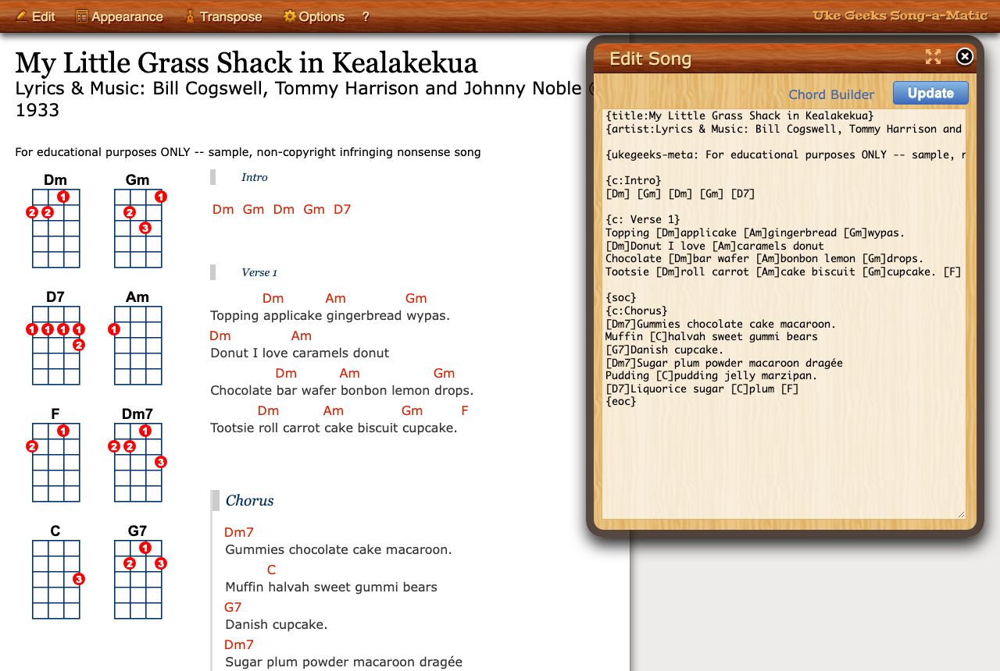
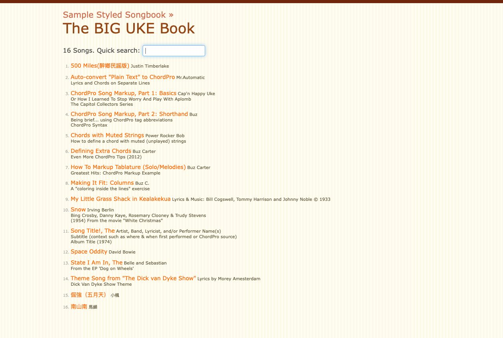

# UkeGeeks Songbook

**Your ukulele club's songbook, on your own website.** Drop your songsheets into a folder and the Songbook turns them into a song list with quick search and clean, printable song pages with chord diagrams. Its built-in Song-a-matic editor lets players transpose, switch tunings and resize a song before printing it.

**Try it:** [live demo](https://buzcarter.github.io/UkeGeeks/)



## Quick start

You need [Node.js](https://nodejs.org/) 18 or newer. No other installs, no database.

```bash
npm start
```

Then open http://127.0.0.1:8080/ in your browser.

**Prefer PHP?** If your web host runs PHP and Apache, the same songbook runs there too: see [Running the songbook with PHP](docs/php-songbook.md).

## Adding your songs

Songs live in the `cpm/` folder, one plain-text file per song, named `something.cpm.txt`. They're written in ChordPro: chords go in square brackets right where they change, like `[C]Mary had a [G7]little lamb`. The sample songs in `cpm/` show the markup, and the [User's Guide](https://ukegeeks.org/blog/users-guide/) and [ChordPro Markup Reference](https://ukegeeks.org/blog/users-guide/chordpro-markup-reference/) cover the rest.

You can also add and edit songs in the browser once you've set up an account.



## Settings

Copy `ugs.config.example.json` to `ugs.config.json` to set your songbook's title, require a login, add editor accounts, or share it on your network. See [Configuration](docs/configuration.md), which also shows how to change the editor's defaults (font size, tuning, theme).

## Building

The pages load prebuilt JavaScript and CSS, so you don't need to build to run the songbook. If you change anything under `src/`:

```bash
npm install
```

```bash
npm run build
```

See [Building, CI and the demo site](docs/building.md) for what the build does, the static demo and the GitHub Actions workflow.

## Tests

```bash
npm test
```

## More

- [Changelog](CHANGELOG.md): what's new in each release.
- [Song pages on your own site](docs/static-html.md): the static HTML demos and the song-rendering API.
- [Technical reference and tips](https://ukegeeks.org/blog/technical-reference/) on the UkeGeeks blog.

## Part of the UkeGeeks family


- **[ukegeeks.org](https://ukegeeks.org)**: edit a song online, the User's Guide, and the blog.
- **[UkeGeeks Songbook](https://github.com/buzcarter/UkeGeeks)** (this repo): your own songbook app, run with Node.js or PHP.
- **[Song Formatter](https://github.com/buzcarter/song-formatter)**: chord diagrams and songsheets on your own website.
- **[ACE ChordPro Extension](https://github.com/buzcarter/ace-chordpro-extension)**: ChordPro editing for the Ace code editor.

Not sure which one you need? See [which UkeGeeks tool is right for you](https://ukegeeks.org/projects/).

## Authors

- [Buz Carter](http://pizzabytheslice.com) (buz@ukegeeks.org)

Contributors: David Calam ([djc-503](https://github.com/djc-503)), [louis-coding](https://github.com/louis-coding), AceLan Kao ([acelan](https://github.com/acelan)) and [hutzelknecht](https://github.com/hutzelknecht).

## License

Licensed under the [GNU General Public License](https://www.gnu.org/licenses/gpl.html). Use it, change it, fork it, but please keep the author attribution.

_ukegeeks.com is no longer affiliated with this project; the official site is [ukegeeks.org](https://ukegeeks.org)._
