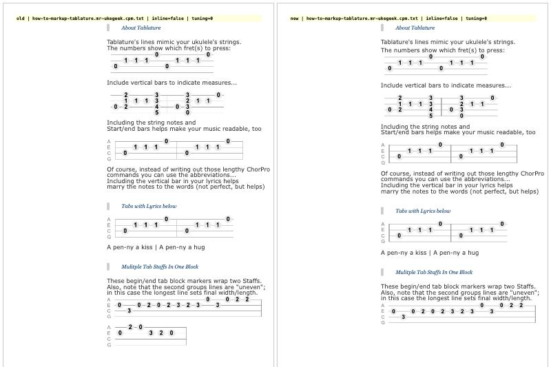
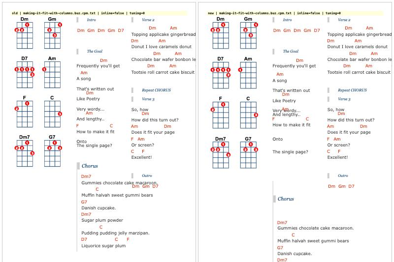
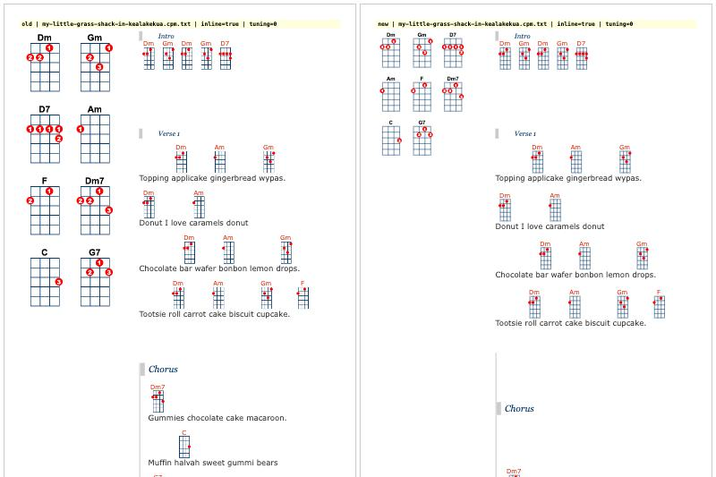
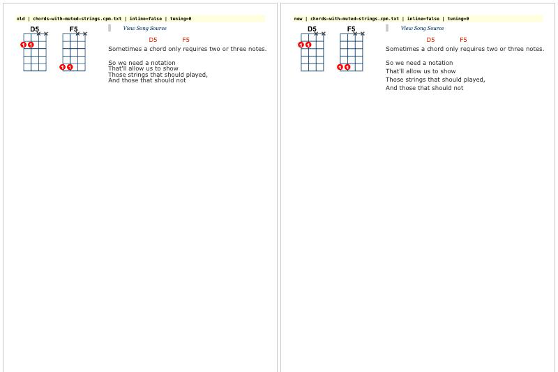

# Review: song-formatter and ace-chordpro-extension

Reviewed on 2026-11-04 against UkeGeeks `master` @ 188dd7a (v1.5.1).

- song-formatter: `buzcarter/song-formatter` @ d1f07d4 (2023-09-13), npm `@ukegeeks/song-formatter@0.0.3-alpha`
- ace-chordpro-extension: `buzcarter/ace-chordpro-extension` @ 53fd6c4, npm `@ukegeeks/ace-chordpro-extension@0.0.3-alpha`

This review covers verification, a code walkthrough, a TypeScript review and a gap analysis. Nothing was changed in either project or in this repo, apart from this report and the screenshots in `docs/review/img/`.

## TL;DR

**song-formatter builds, tests and lints cleanly, but it is not ready to replace Scriptasaurus.** Chord detection, reference diagrams, mini-diagrams, `{define}` chords and muted strings match the old library exactly at standard tuning. Several things do not match, though:

- **Transposing is broken.** It drops the chord quality whenever the target root is a natural note: Em −5 → `B`, G7 +2 → `A`.
- The same bug **corrupts baritone diagrams**, and **ADF#B (−2) is ignored**.
- Parser state **leaks between songs and between editor re-runs**: the column count grows on every Update, and the key "sticks".
- The HTML builder emits **nested `<pre>` blocks**, which merges lines and breaks column layouts.
- Multi-staff tab blocks **lose every staff after the first**.
- **Nothing is HTML-escaped**, so it relies entirely on its input already being escaped.
- `run(markup)`, `toolsLite.trim/escapeHtml` and `definitions.instrument.alternateUke` are missing.

**The parsing and SVG layers do run in Node with no DOM**, which is the most valuable thing about the rewrite. The published bundle, however, is a browser-only window global with no exports and no types.

**ace-chordpro-extension works** (demos and `dist/` bundle, including under the Songbook's CSP). It is close to a drop-in replacement for `js/ace/ace.js`. Only two `ugsAce` references in `ugsEditorPlus.resize.js` need to change. Its README says ACE 1.27.0, but the vendored ACE is actually **1.26.0** (latest is 1.45.2).

**Recommendation:** integrate the ace extension now; it's small and self-contained. Do **not** swap in song-formatter yet. First fix the "must" items in [Gap list](#gap-list-with-effort), add a module/Node entry point, and get the parity harness (below) to zero differences. After that, vendoring the built `dist/` into `js/` at build time is a sound plan.

## A. Does it work?

### Install, test, build (Node 24.14.0, npm 11.9.0; both repos' `.nvmrc` say 18)

| Step | song-formatter | ace-chordpro-extension |
|---|---|---|
| `npm ci` | OK (751 packages; `npm audit`: 28 vulns, 1 critical, all dev-only) | OK (295 packages; 13 vulns, dev-only) |
| `npm test` | **OK: 10 suites, 240 tests, 0.8 s** | n/a (no tests; `jest.config.cjs` and `.babelrc` exist but jest isn't a dependency) |
| `npm run build` | OK: `dist/song-formatter.bundle.js` 47 KiB, `.css` 4.9 KiB | OK: `dist/ace-chordpro.min.js` 558 KiB (webpack size warning only) |
| `npm run lint` | OK, clean | **47,134 problems**: `.eslintignore` lists `src/scripts/ace/...`, but the vendored files live in `src/ace/`, so ESLint lints all of ACE. The hand-written files alone have 2 errors (`window` is not defined). |
| `tsc --noEmit` | OK, 0 errors (`strict: true` is already on) | n/a |

No fixes were needed to run on Node 24. Notes:

- Both `build:clean` scripts call `rimraf`, which isn't a declared dependency. It only works because ESLint 8 pulls in `rimraf@3` transitively; ESLint 9+ won't. Replace it with `node -e "fs.rmSync(...)"` or add it explicitly.
- `buildHeaderTask.js` uses `mkdirSync('.tmp')` without `{ recursive: true }`, so `npm run build:header` fails if run twice without a clean.
- The song-formatter build prints `caniuse-lite is outdated`.
- Neither CI workflow runs `tsc`, lint, or a build of the demo.

### Live demos and local builds (browser)

| Page | Result |
|---|---|
| https://buzcarter.github.io/song-formatter/ | **404.** `publishDemo.yml` deploys only `dist/` to `gh-pages`; `demo/index.html` (which loads `../dist/…`) is never published. `gh-pages` contains just the 7 `dist` files. |
| song-formatter `demo/index.html`, local build | Works, no errors. One leftover `console.log("run (Classic Mode)")` from `scriptasaurus.ts:23`. |
| ace `editor.html` (live) | Works. Highlighting, `t`+Tab snippet → `{title: title}`, Ctrl+Space lists the song's chords with counts. Console: only a 404 for the missing `favicon.ico`. |
| ace `basic.html` (live) | Works, same favicon 404. |
| ace `dist/ace-chordpro.min.js` (local test page) | Works as a single file: mode, theme, snippets, chord completer, no errors. **`ace.version` is "1.26.0".** Note the demos load `src/ace/*.js`, not `dist/`, so the bundle isn't exercised by any published page. |
| ace `dist/` under the Songbook's CSP (`script-src 'self'`, `style-src 'unsafe-inline'`) | Works, with no CSP violations. ACE injects `<style>` tags, which `style-src 'unsafe-inline'` allows. |

## B. Understanding song-formatter

### Module map

```
src/js/
├── index.ts            public API; assigns window.ukeGeeks (legacy names)
├── scriptasaurus.ts    init / run / runByClasses / setTuningOffset
├── configs/            settings singleton, instrument offsets, soprano chord dictionary
├── tools/              logger, pack(), clean(), dictionary types
├── cpmImporter/        ChordPro text → Song (parsing)      ─┐
├── tunings/            chord dictionary, lookup, transpose   ├─ no DOM
├── imageRenderer/      Chord/Tab → SVG string                ─┘
└── htmlBeast/          the DOM layer: finds elements, writes innerHTML, overlap fixer
```

| Module | Owns | Main types |
|---|---|---|
| `cpmImporter` | Turning ChordPro text into a `Song`: block splitting (`textToSongBlocks`), `{verb: args}` instructions, column breaks, chord-line classification, tab expansion, `{define}` parsing. | `Song` (title, artist, st/st2, album, key, ugsMeta, chordDefs, chordNames, columnCount, hasChords, songBlocks); `SongBlock` = `{ type: BlockTypes, lines: (string \| SongBlock)[] }`; `TabBlock` = `{ type, tabs: string[][], hasLabels }`; `Chord` (name, dots, muted); `Dot` (string, fret, finger); `BlockTypes` / `CpmInstructions` enums. |
| `tunings` | The chord dictionary: `addInstrument(text)` stores a CPM `{define}` block, `setInstrument(index, offset)` parses it into `chordCache`, `get(name)` looks up user-defined then built-in chords (aliasing A#→Bb etc., remapping through `retuneMap` when an offset is set). `transpose.ts` has `shift`, `shiftChords`, `retune`. | `Instrument` (key, name, tuning, chords), `RetuneMap`. |
| `imageRenderer` | Drawing. `ImageBuilder` records shapes in a format-neutral tree (image → groups → circle/line/rect/text); `imageSVG.toSVGString` serialises it. `chordSVG.generateChordSvg` draws a fretboard, dots, finger numbers, fret labels and muted Xs; `tabSVG.generateTabSvg` draws a tab staff. | `ImageBuilder`, `SVGImage`/`SVGLayer` union, `FretBox`, `Position`, `LayerTypes`. |
| `htmlBeast` | Everything that touches `document`: `handles.ts` finds the elements (by id or by class), `page.processSong` runs the pipeline, `song.ts` turns blocks into HTML strings, `chords.ts` wraps `[C]` in `<code><strong><em>`, `referenceDiagrams.ts` plots the grid and inline diagrams, `overlapFixer.ts` nudges overlapping chord names. | `HTMLHandles` (wrap, diagrams, text, meta). |
| `configs` | `settings` (fonts, colors, fretBox, inlineFretBox, ids, wrapClasses, opts, tuning, tabs, commonChords), `InstrumentTunings` (none/sopranoUke = 0, baritoneUke = 5), the soprano dictionary, `scaleSettings.scale()` (unused). | `Settings` is inferred from the object; `TabSettings`. |
| `scriptasaurus` | The legacy entry points: `init`, `run`, `runByClasses`, `setTuningOffset`, the unknown-chord `alert`. | |
| `index` | Builds the public object, adds legacy aliases (`chordBrush`, `chordImport.runLine`, `overlapFixer.Fix`, `toolsLite.*`, `transpose.*`), and assigns it to `window.ukeGeeks`. | `ChordBrush extends Chord` (only to expose `plot`). |

### How data flows

```
#ukeSongText.innerHTML  (already HTML-escaped by the server)
  │
  ▼ cpmParser.parseCPM(text)                                   [cpmImporter]
  │   stripHtml → textToSongBlocks → parseInstructions → parseSimpleInstructions
  │   → markChordLines → expandTabs (tabs.readTabs)
  │   getInfo() pulls title/artist/key/defines out of the blocks
  │   definitions.replace(song.chordDefs)    ← side effect on tunings
  │   song.chordNames = getChordNames(text)
  ▼
Song { songBlocks, chordNames, chordDefs, title, key, columnCount, ... }
  │
  ▼ song.songToHTML(song, {exclude: meta})                     [htmlBeast]
  │   blocks → <h1>/<h6>/<pre class=ugsChords>/<div class=ugsChorus>/...
  │   TabBlock → tabSVG.generateTabSvg → <svg>                 [imageRenderer]
  │   chords.markupChords: [C] → <code data-chordName="C"><strong><em>C</em></strong></code>
  ▼
text.innerHTML = html
  │
  ▼ referenceDiagrams.show(chordNames)
  │   tunings.get(name) → Chord → chordSVG.generateChordSvg → ImageBuilder
  │   → svgPlot.plot → <span class=ugs-diagrams--chord-img>.innerHTML = <svg>
  ▼ (optional) showInline → same, into each <code>
  ▼ overlapFixer.Fix(text)
```

### Where global and mutable state lives

There are no instances; every module is a singleton with module-level `let`s. This is the root cause of most of the behaviour bugs below.

| State | Where | Reset? |
|---|---|---|
| `settings` (whole object, `Object.seal`ed but mutable) | `configs/settings.ts:12` | Never. The editor mutates it directly (`opts.*`, `colors`, `inlineDiagrams`, `commonChords`). `metaParser.runBlock` overwrites `settings.tuning` as a side effect (`metaParser.ts:54`). |
| `hasChords`, `columnCount`, `firstChord` | `cpmImporter/cpmParser.ts:55-59` | **Never.** Every subsequent parse inherits them (see Parity). |
| `errs` | `cpmImporter/errorWriter.ts:3` | Never; grows forever. |
| `instruments`, `userChords`, `chordCache`, `globalOffset`, `retuneMap` | `tunings/chordDefinitions.ts:12-20` | `userChords` is replaced on every parse (`definitions.replace` inside `parseCPM`, so parsing has a side effect on lookup); `retuneMap` is only rebuilt when offset > 0. |
| `errList` | `htmlBeast/page.ts:10` | **Never**: `errList = errList.concat(getErrors())` (`page.ts:47`), so in the editor the unknown-chord alert keeps listing chords from earlier runs. |
| `errors`, `handles`, `ignoreMatchList` | `htmlBeast/referenceDiagrams.ts:19-27` | Reset per `show()`; `handles` is a module global set by `init()`. |
| `window.ukeGeeks` | `index.ts:61` | Merged onto any existing object. |

`definitions.useInstrument(offset)` (`chordDefinitions.ts:28`) is how tuning is changed: it reparses the whole soprano dictionary on every call.

## TypeScript review (song-formatter)

The code is better typed than "new to TS" suggests. `strict: true` is already on (`tsconfig.json`), `tsc` passes with 0 errors, and lint is clean. The issues are about what is being **hidden** from the compiler, and about types that don't describe runtime reality.

### What the escape hatches hide

There are 17 `@ts-ignore`s and 31 `as` casts. Deleting every `@ts-ignore` and re-running `tsc` gives **19 errors**; each one points at a real problem:

| File:line | What's hidden |
|---|---|
| `index.ts:15-19` | The `plot(...args)` workaround. `args` is implicit `any[]` and the spread isn't a tuple. `ChordBrush extends Chord` only to add a `plot` method that ignores `this`. Fix: `plot(...args: Parameters<typeof plot>) { plot(...args); }`, and don't extend `Chord` (a brush isn't a chord; the old API just needs `new chordBrush().plot(...)`). |
| `index.ts:60-61` | `window.ukeGeeks`: needs a `declare global { interface Window { ukeGeeks?: … } }`. |
| `chordParser.ts:49, 93, 102` | The `reduce` accumulators are inferred as `{ string: null, fret: null, finger: null }` and `{ frets: never[] … }`, so every write is an error. They need typed initial values (`as AddIn`, `as DefineParts`). The `null`s also flow into `new Dot(null, null, null)` when an `add:` is incomplete; the types don't allow that, but the runtime does it. |
| `cpmParser.ts:312-315` | `expandTabs` reads `block.lines` on a `TabBlock` (which has no `lines`), then mutates the object in place from `SongBlock` into `TabBlock` with `Object.assign(clean(block), …)`. The type guard can't describe a block that changes type. Return a new array instead of mutating. |
| `cpmParser.ts:325-336` | `getInfo` treats `lines` as `SongBlock[]` when it's `(string \| SongBlock)[]`. |
| `ImageBuilder.ts:60, 154` | `#context.current.layers` (`SVGBase` has no `layers`) and `getData()` returning `SVGImage \| null` as `SVGImage`. |
| `scaleSettings.ts:27`, `debugWriter.ts:8`, `overlapFixer.ts:64, 89` | Assorted unsound index/`unknown` accesses; `overlapFixer` still probes IE's `clip`/`pixelWidth`. |

`// @ts-ignore-next-line` is not a TypeScript directive. It works only because TS matches the `@ts-ignore` prefix. Prefer `// @ts-expect-error` (it fails when the error goes away), and fix rather than suppress.

### Types that don't match runtime

- **`ImageBuilder implements SVGImage`** (`ImageBuilder.ts:19-34`) declares `dimensions`, `layers` and `type` fields that are never used; the real data lives in `#context.root`. The class satisfies the interface on paper only. Drop `implements` and those three fields.
- **`type: verbToBlockTypeHash[verb] || \`Undefined-${verb}\``** (`cpmParser.ts:231`) stores a *string* in a `BlockTypes` (numeric enum) field. Unknown directives such as `{capo: 2}` produce a block whose `type` isn't a `BlockTypes` at all. Use `BlockTypes.Undefined` plus a separate `verb` field.
- **`runLine` returns an object literal, not a `Chord`** (`chordParser.ts:123`). That works because TS is structural, but `instanceof Chord` would be false; meanwhile `Dot.string/fret/finger` are typed `number | null`, so every consumer has to `|| 0`.
- **`FretBox` has `[index: string]: any`** (`FretBox.ts:4`), which disables checking on every property access through it.
- **`Settings` has no declared type.** It's inferred from a literal with `as StringDict` / `as BooleanDict` casts, so `settings.opts.typo` type-checks. Give it an interface; export `Readonly<Settings>` from the getter and add an explicit `configure(partial)`.
- **`JsonData`** (`CoreTypes.ts:5`) is used as an "any object" escape (`init(options?: JsonData)` then `<string>options?.definitions`).
- **`scriptasaurus.run()` mutates `Song`** with `Object.assign(song, { chords: song.chordNames })` (`scriptasaurus.ts:31`), so the returned object has a property the `Song` type doesn't declare.

### What stricter flags would surface

`strict` is already on. The next useful flag is **`noUncheckedIndexedAccess`: 59 errors**, concentrated in `chordSVG.ts` (10), `cpmParser.ts` (8), `handles.ts` (7) and `tabs.ts` (7). That's exactly where the tab parser assumes 4 lines (`tabStrings[getNumStrings() - 1][0]`) and silently ignores extra staffs. Adding `noPropertyAccessFromIndexSignature`, `noUnusedLocals/Parameters` and `exactOptionalPropertyTypes` adds 29 + 5 + a few more. I'd turn on `noUncheckedIndexedAccess` and fix those 59; skip the rest until 1.0.

### Dead or duplicated code

- `isSongBlock`/`isTabBlock` are defined twice (`cpmParser.ts:62-63`, `song.ts:18-19`).
- `scaleSettings.ts` (0% covered) and `debugWriter.ts` are unused by the pipeline. `errorWriter.echo` is never called. `htmlBeast/Styles.ts` has `ChordsStyles`/`SvgChordStyles` not frozen, unlike the others.
- `chords.ts:33-41` keeps a commented-out old implementation; `cpmParser.ts:228` has an "IE7 bug" `\r` strip; `referenceDiagrams.ts:59` checks `typeof Array.prototype.indexOf === 'function'`.
- `transpose.ts:96`: `const hasOffset = offset === 0`, a name that says the opposite of the value.
- `@types/jquery` is a devDependency but nothing uses jQuery.

### Tests

There are 240 tests, all in `.js` files run through `babel-jest` with `@babel/preset-typescript`. That means **tests are never type-checked**, and the TS is compiled two different ways (ts-loader for the build, Babel for tests). Coverage is 59% lines overall:

| Area | Lines covered |
|---|---|
| `imageRenderer` | 95% |
| `cpmImporter` | 79% |
| `tunings` | 71% |
| **`htmlBeast` (HTML building, the nested-`<pre>` and escaping bugs live here)** | **0%** |
| `index.ts`, `scriptasaurus.ts` | 0% |

The `shift` tests (`transpose.test.js:48-61`) cover `Bbdim7`-style cases (flat targets, which have two spellings) and a bare `C`, which is exactly the pair that hides the suffix-dropping bug. There are no golden-file tests of `songToHTML` output, which is what a parity effort needs most.

### Tooling

| Tool | In use | Current | Note |
|---|---|---|---|
| TypeScript | 4.9.5 (`^4.6.2`) | 7.0.2 | Go to 5.x first (5.x is a drop-in); 7 is the native compiler. |
| ESLint | 8.49 (eslintrc, airbnb-base) | 10.14 | ESLint 8 is EOL; flat config + `typescript-eslint` 8. |
| typescript-eslint | 6.6 | 8.72 | |
| Jest | 29.6 + Babel | 30.5 | Or switch to Vitest/`node --test` + `tsx` and type-check tests. |
| webpack | 5.88 + ts-loader + a second config just for CSS | 5.112 | For a library, `tsc` (ESM + `.d.ts`) plus `esbuild` for the IIFE bundle is far simpler. |
| Babel | 7.22 (tests only) | 8.0 | Not needed if tests run on TS directly. |
| Node in CI | `node:18` container | Node 18 is EOL | Use 22/24; also update `.nvmrc`. |

### Prioritised refactors before a 1.0

**Must**

1. Move per-parse state into a parse context: `hasChords`, `columnCount`, `firstChord` (`cpmParser.ts:55-59`), `errList` (`page.ts:10`), `errs` (`errorWriter.ts`). `parseCPM` must be a pure function of its input.
2. Fix `shift()` (`transpose.ts:63-65`): return `key + suffix` and choose the spelling deliberately (the old library prefers sharps). Add tests for minor/7th chords landing on natural notes.
3. Support negative tuning offsets (`chordDefinitions.ts:34, 58` use `> 0` / `< 1`; the old library uses `!= 0`) and add `alternateUke: -2`. Compute `retuneMap` *after* `setChords` (`chordDefinitions.ts:34-44`).
4. Fix `songBlocksToHTML` index handling (`song.ts:87-88`): it looks up neighbours in the *unfiltered* `songBlocks` with the index from the *filtered* array, which opens a second `<pre>` without closing the first.
5. Escape everything that goes into HTML/SVG: text lines, headings, `data-chordName` attribute values (quotes!), SVG `<text>`. Use the same entity-preserving rule as `server/lib/html.js`.
6. Read all staffs in a tab block, not just the first `getNumStrings()` lines (`tabs.ts:31`, `getFretNumbers`, `getSymbols`).
7. Ship a real package: an ESM/CJS entry for the DOM-free core (parse → HTML string + SVG), with `.d.ts`, and keep the IIFE `window.ukeGeeks` bundle as a separate file.

**Should**

8. Remove the 17 `@ts-ignore`s by typing the reducers, splitting `TabBlock` creation from `SongBlock`, and giving `ImageBuilder` a typed context.
9. Give `Settings` an interface; stop `metaParser.runBlock` writing `settings.tuning`; pass settings into renderers instead of importing the singleton.
10. Add `run(markup)` with escaping, `toolsLite.trim`, `toolsLite.escapeHtml`.
11. Golden tests: render every file in UkeGeeks `cpm/` and snapshot the HTML. Cover `htmlBeast`.
12. Turn on `noUncheckedIndexedAccess`; type-check tests.
13. Fix the demo deploy (publish `demo/` too) and add `tsc --noEmit` and lint to CI.

**Nice**

14. Replace webpack/Babel with `tsc` + `esbuild`; move to ESLint flat config; TS 5.x.
15. Remove IE leftovers (`clip`, `pixelWidth`, `\r` "IE7 bug", `indexOf` check) and `@types/jquery`.
16. Drop the `alert()` for unknown chords from the library; return the list and let the page decide.
17. Remove the stray `logger.log('run (Classic Mode)')`.

## ace-chordpro-extension review (hand-written parts)

The repo is about 1.1 MB of vendored ACE (`ace.js`, `ext-language_tools.js`, `ext-inline_autocomplete.js`, `ext-searchbox.js`, `theme-idle_fingers.js`), plus about 9 KB of original code.

`src/ace/mode-chordpro.js` (218 lines):

- It's a clean port of the Songbook's `js/ace/mode-chordpro.js`. It adds `chordpro_autocomplete_chords`, a mode-owned chord completer (previously `ugsAce.chordCompleter` in `src/js/ace/ugsAce.js`), and `snippetFileId`.
- **Global side effect:** `setCompleters([ChordProAutocompleteChords])` runs at module load (line 193). That replaces the completers for *every* editor on the page, and removes ACE's keyword and snippet completers from the Ctrl+Space popup. Confirmed in the live demo: the popup lists only `[A7] [B7] [D7] [E7] [G]`. If that's intended, document it; otherwise use `editor.completers` or `addCompleter` from the host page.
- **Typo:** the token `'constant.mumeric'` appears at lines 70 and 99 (it should be `constant.numeric`), so numbers in `{define}` and tab blocks get no theme colour. Confirmed via `session.getTokens()`.
- `getTagRule` / `getStartRule` / `getEndRule` (lines 110-132) are leftovers from a doc-comment mode and are unused.
- The `chordpro_autocomplete_chords` module declares unused deps (`oop`, `text_highlight_rules`).
- The comment on `reOpenBrace` says "no spaces allowed", but the regex allows `^\s*{`.
- The trailing `window.require([...])` IIFE (lines 212-217) is the ACE "loader shim" pattern. It's fine in a browser but is why ESLint reports `window` undefined. Add `/* eslint-env browser */`.

`src/ace/snippets/chordpro.js`:

- Same snippets as the Songbook's.
- Several of the `+ '# …'` lines are mis-indented (lint would catch this if ESLint were pointed at the right files).
- The `tab` and `d` snippets hard-code 4 strings (`A E C G`), which is fine for ukulele.

Build (`webpack.config.cjs`, `tasks/buildHeaderTask.js`):

- webpack is only used as a file concatenator (`webpack-concat-files-plugin`) with a dummy entry that emits `dist/empty.js`. A 20-line Node script with `terser` would do the same job.
- The licence header is concatenated **after** the code (`src: ['./src/ace/**/*.js', '.tmp/header.js']`), so it ends up at the bottom of the file. Terser keeps only the `/**!` block; the ACE BSD licence text (a plain `/*` comment) is stripped, which matters for BSD attribution.
- The CSS in `src/styles/` isn't built into `dist/` ("until I fix WebPack CSS script").
- The npm package ships `src/`, both demos and `dist/`.
- **Version mismatch:** the README and the build header say ACE 1.27.0, but `src/ace/ace.js` is `version = "1.26.0"`. Current `ace-builds` is 1.45.2. Consider depending on `ace-builds` and copying the needed files at build time, instead of vendoring.

## C. Mapping song-formatter onto the Songbook

### 5. Rendering parity

**Method.** I used a harness of two pages:

- `render.html` reproduces the Songbook's song view: the same element ids and classes. The ChordPro text is escaped with the same regex as `server/lib/html.js` and put into `#ukeSongText pre`. The page then runs either the old library (`js/ukeGeeks.scriptasaurus.min.js` from master) or song-formatter (`dist/` built from d1f07d4).
- `compare.html` runs all 16 songs in `cpm/` × 4 configurations (standard; mini-diagrams on; baritone +5; ADF#B −2) and diffs the results. That's 128 renders, with 0 JS errors and 0 timeouts.

The harness lived in the session scratchpad; it can be recreated from this description if needed.

| Check | Result |
|---|---|
| Chords found (`song.chords`), order | **Identical** for all 16 songs. |
| Key, `hasChords` (first render on a page) | Identical. |
| Reference diagrams (count) | Identical at standard tuning. |
| Fingerings (dots, fingers, muted) for every chord in every song, standard tuning | **Identical**, including all `{define}` chords (`Gm7b5`, `C-2pos`, `C-alt`, `Ice`, `Cream`, `Pie`, `G-alt` with `add:` dots) and muted-string chords (`D5`, `F5`). |
| Mini-diagrams above lyrics (count) | Identical. Visually, song-formatter's CSS also shrinks the **reference** diagrams when inline mode is on (`ukeGeeks.music.css:301`, `.ugsInlineDiagrams .ugs-diagrams--chord-img svg` matches both kinds). |
| Muted strings | Identical X positions. |
| Tabs | **Differs**: "Multiple Tab Staffs In One Block" (`how-to-markup-tablature`) renders 1 staff instead of 2; the parser reads only the first 4 lines of a tab block. |
| Song text / layout | **Differs in 13 of 16 songs.** song-formatter emits extra `<pre>`s, and in 10 songs *nested* `<pre>` (e.g. `my-little-grass-shack`: 3 → 6 `<pre>`, 2 nested). Visible effects: missing line breaks ("drops.Tootsie", "played,And"), lines overlapping ("Very wordy… / And lengthy.."), and the chorus falling out of its column. Cause: `song.ts:87-88`. |
| Columns | Only `making-it-fit-with-columns` has a `{column_break}`, but because `columnCount` is never reset, **every song parsed after it on the same page/process is wrapped in 2 columns**. In the editor, each Update adds one: measured 3 → 4 → 5 columns over three runs. |
| Transposing (`transpose.shift`, steps −6…+11) | **Differs for every chord with a suffix.** Em −5 → `B` (expected `Bm`), G7 +2 → `A` (`A7`), Dm7 −5 → `A` (`Am7`), Cmaj7 +7 → `G` (`Gmaj7`). Cause: `transpose.ts:63-65`, where `reduce()` without an initial value returns the bare note when only one spelling exists. Spelling also changes: old prefers sharps (`F#m`), new prefers flats (`Gbm`). Both libraries leave slash-chord basses alone (`G/B` +2 → `A/B`). |
| Baritone (+5) | **Differs for 13 chords.** Old Am → soprano Dm shape (correct for DGBE); new Am → soprano **D major** shape, because retune uses the broken `shift`. New also "finds" `G/B` (as a C shape) where old correctly reports it unknown. |
| ADF#B (−2) | **Ignored.** New diagrams are byte-identical to standard tuning; old draws them correctly (e.g. G → soprano F shape). `alternateUke` isn't even defined in `definitions.instrument`. |
| Unknown-chord alert | Same text on first render. |

Screenshots (old library left, song-formatter right):









### 6. API parity

Every `ukeGeeks.*` member used by `src/js/editor/*.js`, `js/startup.js` and the server views (`server/views.js` only loads the script and CSS):

| Member | Used by | song-formatter |
|---|---|---|
| `scriptasaurus.init(isIe)` | startup.js, songAmatic.js | Yes (`init(options?)`; a boolean is harmless) |
| `scriptasaurus.run()` | startup.js | Yes |
| **`scriptasaurus.run(markup)`** | **actions.js:171** (the editor's main render) | **No.** The argument is ignored; it renders whatever is already in `#ukeSongText` (verified: renders an empty song). Needs adding, with escaping. |
| `scriptasaurus.setTuningOffset` | actions.js:340 | Yes, but negative offsets are ignored (see above). |
| `definitions.instrument.sopranoUke / baritoneUke` | actions.js:326-330 | Yes |
| **`definitions.instrument.alternateUke`** | actions.js:335 | **No** (`undefined`) |
| `transpose.shift`, `transpose.shiftChords` | actions.js:381, 403, 431 | Present, but returns wrong chords (see above). |
| `chordImport.runLine` | ugsChordBuilder.chooserList.js:215, 332 | Yes |
| `chordBrush` (`new …().plot(el, chord, dims, fonts, colors)`) | chooserList.js:336-338 | Yes, same signature |
| `overlapFixer.Fix` | actions.js:274 | Yes |
| `toolsLite.addClass / removeClass / setClass` | actions.js, autoReformat.js | Yes |
| **`toolsLite.trim`** | actions.js:488 | **No** (TypeError when saving "common chords") |
| **`toolsLite.escapeHtml`** | used by the old `run(markup)` | **No** |
| `settings.opts.{retainBrackets, sortAlphabetical, ignoreCommonChords}`, `settings.commonChords`, `settings.inlineDiagrams`, `settings.colors`, `settings.tabs.{lineColor, dotColor, textColor}`, `settings.fretBox.{width,height}`, `settings.inlineFretBox(.fonts)` | actions.js, themes.js, songAmatic.js | Yes, same names |
| Returned song: `.chords`, `.key`, `.title`, `.artist`, `.album`, `.st`, `.ugsMeta` | actions.js:173-184, songUi.js:39-52 | Yes (`.chords` is aliased from `chordNames`) |
| CSS class names (`ugsChords`, `ugsPlain`, `ugsTabs`, `ugsInlineDiagrams`, `ugsNoChords`, `ugs-song-wrap`, …) | Songbook CSS, editor | Same names; diagrams are now `<span class="ugs-diagrams--chord-img"><svg>` instead of `<canvas>`, so any Songbook CSS targeting `canvas` (e.g. editor theme and print styles) needs updating. |

### 7. Security

**The Songbook's rule** (`server/lib/html.js:20-33`): escape `< > " '` and bare `&`, but leave existing entities alone. The editor's `run(markup)` does the same via `toolsLite.escapeHtml` (`ukeGeeks.toolsLite.js:77-82`), except **it doesn't escape quotes**. The CSP (`server/lib/http.js:43`) is `script-src 'self' 'nonce-…'`, with no `'unsafe-inline'` for scripts.

**song-formatter does no escaping at all.** Every HTML path is string concatenation that ends in `innerHTML`:

- `song.ts:52-67`: title, subtitle, album, artist, ugsMeta and comments go into `<h1>`…`<h6>`.
- `song.ts:90`: lyric lines.
- `chords.ts:29`: the chord name goes into `data-chordName="…"` and `<em>…</em>`.
- `imageSVG.ts:87`: `<text>${layer.text}</text>` gets the chord name inside the SVG.
- `referenceDiagrams.ts:77`: "Also uses:" list.
- `svgPlot.ts:11`: the SVG string goes into a `<span>.innerHTML`.

In a browser on the Songbook, this is safe only because `processSong` re-reads `text.innerHTML` (`page.ts:29`), which the server has already escaped. Fed raw text in Node, it passes everything through verbatim:

```
<h1 class="ugsTitle"></h1>
<pre class="ugsChords"><code data-chordName="<svg/onload=alert(3)>">…Hi <script>alert(4)</script></pre>
<text …><svg/onload=alert(3)></text>
```

**Pre-existing hole in both libraries.** Reading `innerHTML` turns the server's `&quot;` back into a literal `"`, which is then concatenated into a double-quoted attribute. So `[C" onmouseover="alert(2)]` in a song produces a real `onmouseover` attribute, and the same happens with the **current** Scriptasaurus (`ukeGeeks.chordParser.js:113`). Verified in the browser for both. Under the Songbook's CSP the handler won't run, but the markup is still injected (it could add `style`, `id` and so on). That makes it a defence-in-depth issue today, and a real XSS anywhere the library runs without that CSP (WordPress embeds, the song-formatter demo, other sites). The fix is the same in both libraries: escape `"` when building `data-chordName`, or set it with `setAttribute`.

**Recommendation for song-formatter:** escape at the point of HTML generation, using the Songbook's entity-preserving rule, so it is correct whether the input came from `innerHTML` (escaped) or from a string (raw). Then `run(markup)` doesn't need a separate pre-escape, and Node output is safe by construction. Also stop using `innerHTML` to read the source; take `textContent` (or the markup string) instead. That removes the "already-escaped vs raw" ambiguity entirely.

### 8. Can parsing and SVG run server-side in Node with no DOM?

**Yes, for the parser, the HTML string builder and the SVG renderer; not via the published package.**

Evidence: I compiled `src/js` with the repo's own `tsc` config into CommonJS, then in plain Node 24 (`typeof document === 'undefined'`) imported `cpmImporter.parseCPM`, `htmlBeast/song.songToHTML`, `tunings.definitions` and `imageRenderer.generateChordSvg/toString`. That rendered all 16 songs in `cpm/` to HTML with inline SVG chord diagrams and tabs. The DOM is only touched inside function bodies in `htmlBeast/{page,handles,referenceDiagrams,svgPlot,overlapFixer}.ts` and `scriptasaurus.ts`; importing those modules is safe.

Blockers:

- `dist/song-formatter.bundle.js` throws `ReferenceError: window is not defined` on import, and has **no exports** (webpack has no `library` config). The npm `main` points at it and there's no `.d.ts`, so `npm install @ukegeeks/song-formatter` gives Node users nothing usable.
- The module-level state means a long-running server would leak the column count, key and `hasChords` across requests. That run printed `key=G` for every song after the first, and `columnCount=2` for every song after `making-it-fit-with-columns`.
- There's no escaping (see 7).
- The overlap fixer needs layout, so it can only run client-side. Server-rendered HTML would still load a small client script for that and for interactive tuning/transpose.

### 9. ace-chordpro-extension vs the Songbook's fullscreen editor

The Songbook currently lazy-loads `js/ace/ace.js` (369 KB: ACE from 2014 + language_tools + searchbox + `ugsAce` helpers). ACE then fetches `mode-chordpro.js`, `theme-idle_fingers.js` and `snippets/chordpro.js` from `js/ace/` by path. It uses an old `ext-old_ie.js` too.

**It is nearly a drop-in replacement.** `dist/ace-chordpro.min.js` (558 KB) contains ACE 1.26, language_tools, inline_autocomplete, searchbox, the ChordPro mode, snippets and the idle_fingers theme, all pre-registered. So `ace.edit`, `setTheme('ace/theme/idle_fingers')`, `setMode('ace/mode/chordpro')` and `setOptions({enableBasicAutocompletion, enableSnippets})` work unchanged, with no extra fetches. Verified with a replica of the `resize.js` setup under the Songbook's CSP: no CSP violations, theme and tokens correct.

What changes:

1. `ugsEditorPlus.resize.js:131`: `editor.completers = [ugsAce.chordCompleter]` throws `ugsAce is not defined`. Delete it (the mode now registers the chord completer itself).
2. `ugsEditorPlus.resize.js:135`: `help.innerHTML = ugsAce.helpHtml`. Move the help HTML into the Songbook, e.g. a small `ugsAce.help.js` or a `<template>` in the view; the extension's `editor.html` has an updated version of the same help.
3. Replace `js/ace/{ace.js, mode-chordpro.js, theme-idle_fingers.js, snippets/*, ext-old_ie.js}` with the single bundle. Keep the LazyLoad call pointing at the new file name, and add it to `scripts/build.js` as a copy from `node_modules` (or a vendored file).
4. Optional: the extension's `src/styles/ugs-ace-*.css` uses BEM names (`ugs-ace-hdr`, `ugs-ace-help__…`) that differ from the Songbook's `#aceHeader` / `#aceHelp` styles in its LESS. Keep the Songbook's CSS for now.
5. Check the payload: +190 KB, loaded only on "Fullscreen". Acceptable, but upgrading ACE to 1.45 and dropping `ext-inline_autocomplete` (unused by the mode) would trim it.

## Gap list with effort

S = an hour or two, M = a day or so, L = several days.

| # | Gap | Where | Effort |
|---|---|---|---|
| 1 | Per-parse state leaks (`columnCount`, `firstChord`, `hasChords`, `errList`, `errs`) | song-formatter `cpmParser.ts`, `page.ts`, `errorWriter.ts` | S |
| 2 | `transpose.shift` drops chord suffix; spelling preference | `transpose.ts:51-67` | S |
| 3 | Negative tuning offsets ignored; `alternateUke` missing; `retuneMap` built before chords loaded | `chordDefinitions.ts`, `globalConsts.ts` | S |
| 4 | Nested/extra `<pre>` from filtered-index bug | `song.ts:21-109` | S–M (fix is small; verifying layout parity across 16 songs is the work) |
| 5 | Multi-staff tab blocks lose staffs 2+ | `tabs.ts` | M |
| 6 | HTML/SVG escaping in all output paths (and `textContent` input) | `song.ts`, `chords.ts`, `imageSVG.ts`, `referenceDiagrams.ts` | M |
| 7 | `run(markup)`, `toolsLite.trim`, `toolsLite.escapeHtml` | `scriptasaurus.ts`, `index.ts` | S |
| 8 | CSS parity: inline mode shrinks reference diagrams; stray chorus rule; Songbook CSS that targets `canvas` | `ukeGeeks.music.css:301`, Songbook LESS/CSS | M |
| 9 | Package: ESM/CJS DOM-free entry + `.d.ts` + separate IIFE bundle; fix the demo deploy | song-formatter build/CI | M |
| 10 | Golden-file tests for all `cpm/` songs; `htmlBeast` coverage; type-checked tests | song-formatter tests | M |
| 11 | Remove 17 `@ts-ignore`s; type `Settings`; drop `ImageBuilder implements SVGImage`; enum misuse in `parseInstructions` | song-formatter | M |
| 12 | Tooling refresh (TS 5, ESLint flat, Jest 30/Vitest, drop Babel/webpack, Node 22+ CI) | both repos | M |
| 13 | Songbook-side: escape `"` in `data-chordName` in the **current** library (pre-existing) | `src/js/scriptasaurus/ukeGeeks.chordParser.js:113`, `toolsLite.escapeHtml` | S |
| 14 | Ace: fix `.eslintignore` paths, `constant.mumeric`, header order and licence, ACE version claim; decide on global `setCompleters` | ace-chordpro-extension | S |
| 15 | Ace → Songbook: swap bundle, remove `ugsAce` refs, relocate help HTML | `ugsEditorPlus.resize.js`, `scripts/build.js`, `js/ace/` | S |
| 16 | Server-side rendering in the Songbook (Node render + small client script for overlap fixer/tuning) | `server/`, views | L |

## Recommendation

**ace-chordpro-extension: integrate now** (items 14-15, about half a day). Vendor `dist/ace-chordpro.min.js` into `js/ace/` from `scripts/build.js` (copied from `node_modules/@ukegeeks/ace-chordpro-extension` as a devDependency), so the Songbook keeps zero runtime dependencies. Ideally rebuild it on a current `ace-builds` first.

**song-formatter: not yet.** Vendoring its `dist/` into `js/` at build time is the right integration shape: it keeps zero runtime deps, and the old library can stay side by side under a flag until parity holds. But right now it would regress the editor (transpose produces wrong chords, ADF#B does nothing, columns multiply on every Update, `run(markup)` is ignored) and the song view (merged lines, lost tab staffs). The blocking set is items 1-7 (roughly 2-4 days), plus item 10's golden tests so "matches the old library" is something CI checks rather than something eyeballed.

A suggested order:

1. Fix 1-4 and 7 in song-formatter, with tests.
2. Add golden tests (10) using the Songbook's `cpm/` files, and make the parity harness pass.
3. Fix 5, 6 and 8.
4. Integrate behind a Songbook setting (old canvas / new SVG).
5. Do the package work (9), then server-side rendering (16) as the payoff.

Fix item 13 in the current library regardless; it's a one-line hardening of v1.5.x.
